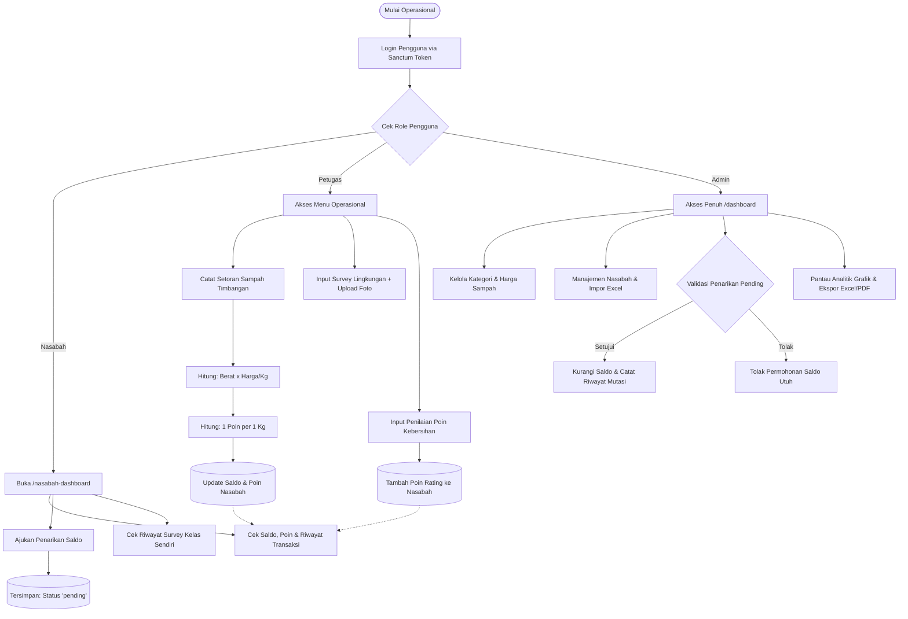
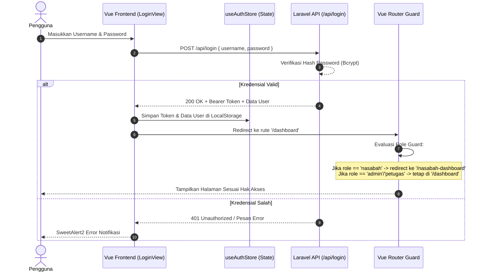
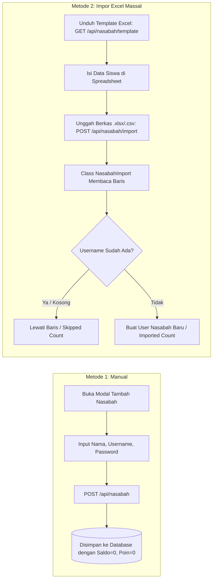
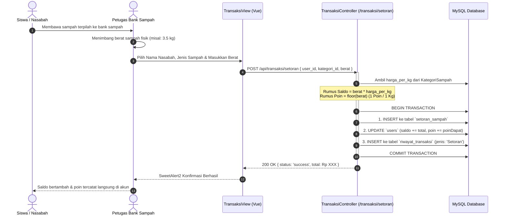
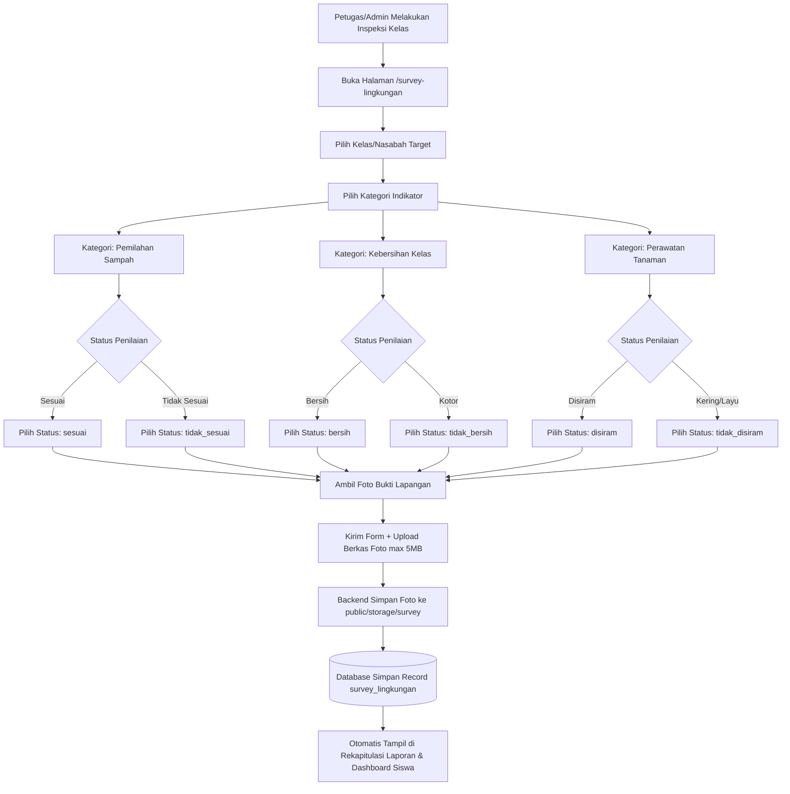
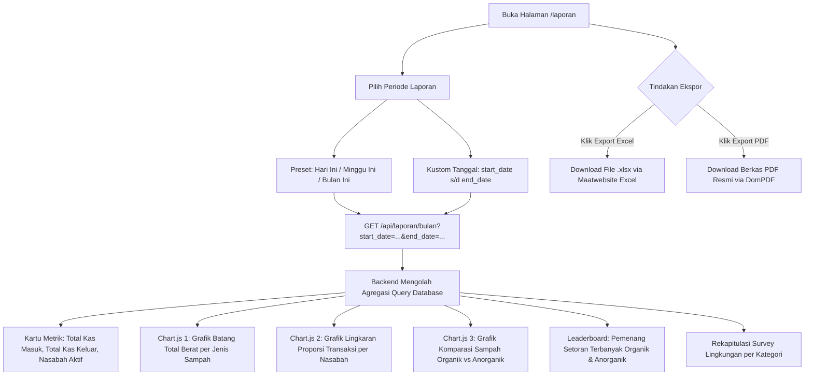

# 📘 Dokumentasi Alur Sistem: Bank Samsul (Bank Sampah Digital)
### SMP 2 Al-Muhajirin Purwakarta

Dokumen ini menjelaskan secara menyeluruh arsitektur alur kerja, logika bisnis, dan siklus transaksi yang berjalan pada sistem **Bank Samsul** (*GreenSaver*).

---

## 📑 Daftar Isi
1. [Ringkasan Eksekutif & Entitas Sistem](#1-ringkasan-eksekutif--entitas-sistem)
2. [Matriks Peran & Wewenang (Role Matrix)](#2-matriks-peran--wewenang-role-matrix)
3. [Peta Alur Kerja Global (Global Business Flow)](#3-peta-alur-kerja-global-global-business-flow)
4. [Alur 1: Autentikasi & Navigasi Antarmuka](#4-alur-1-autentikasi--navigasi-antarmuka)
5. [Alur 2: Manajemen & Onboarding Data Nasabah](#5-alur-2-manajemen--onboarding-data-nasabah)
6. [Alur 3: Manajemen Master Kategori & Tarif Sampah](#6-alur-3-manajemen-master-kategori--tarif-sampah)
7. [Alur 4: Siklus Transaksi Setoran Sampah (Deposit)](#7-alur-4-siklus-transaksi-setoran-sampah-deposit)
8. [Alur 5: Siklus Penarikan Saldo & Workflow Validasi (Withdrawal)](#8-alur-5-siklus-penarikan-saldo--workflow-validasi-withdrawal)
9. [Alur 6: Monitoring & Survey Lingkungan Sekolah](#9-alur-6-monitoring--survey-lingkungan-sekolah)
10. [Alur 7: Sistem Gamifikasi & Penilaian Poin Kebersihan](#10-alur-7-sistem-gamifikasi--penilaian-poin-kebersihan)
11. [Alur 8: Pelaporan, Analitik & Ekspor Dokumen](#11-alur-8-pelaporan-analitik--ekspor-dokumen)
12. [Integritas Data & Database Transaction](#12-integritas-data--database-transaction)

---

## 1. Ringkasan Eksekutif & Entitas Sistem

Sistem **Bank Samsul** dirancang untuk mengelola dua pilar utama dalam lingkungan sekolah:
1. **Pilar Finansial & Edukasi Lingkungan (Bank Sampah)**: Menampung setoran sampah bernilai ekonomis, mengonversinya menjadi saldo tabungan riil, serta memberikan apresiasi berupa poin gamifikasi.
2. **Pilar Monitoring & Tata Kelola Lingkungan Hidup**: Memantau kebersihan ruang kelas, pemilahan sampah harian, dan perawatan tanaman sekolah berbasis dokumentasi foto dan sistem skoring.

### Tiga Entitas Utama:
- **👑 Administrator**: Pemegang kendali penuh operasional, validasi finansial, konfigurasi data master, penilaian poin, serta audit pelaporan.
- **👮 Petugas**: Pelaksana lapangan yang melayani penimbangan setoran sampah nasabah, registrasi nasabah, dan pelaksanaan survey lingkungan di kelas.
- **🎓 Nasabah (Siswa / Perwakilan Kelas)**: Pihak yang menyetorkan sampah, menabung saldo, mengumpulkan poin prestasi lingkungan, dan memantau status kebersihan kelasnya.

---

## 2. Matriks Peran & Wewenang (Role Matrix)

| Fitur / Modul | Admin | Petugas | Nasabah |
| :--- | :---: | :---: | :---: |
| Akses Landing Page Publik & Informasi 3R | ✅ | ✅ | ✅ |
| Autentikasi Login & Logout | ✅ | ✅ | ✅ |
| Akses Dashboard Statistik Global | ✅ | ✅ | ❌ |
| Akses Portal Mandiri Nasabah | ❌ *(Redirect)* | ❌ *(Redirect)* | ✅ |
| Tambah / Edit / Hapus Nasabah | ✅ | ✅ | ❌ |
| Impor Nasabah Massal (Excel) & Download Template | ✅ | ✅ | ❌ |
| Kelola Kategori & Tarif Sampah (CRUD) | ✅ | ❌ | ❌ |
| Input Transaksi Setoran Sampah | ✅ | ✅ | ❌ |
| Penarikan Saldo Langsung (di Loket) | ✅ | ✅ | ❌ |
| Pengajuan Penarikan Mandiri (Status Pending) | ❌ | ❌ | ✅ |
| Validasi Permohonan Penarikan (Setujui / Tolak) | ✅ | ❌ | ❌ |
| Input Survey Lingkungan + Upload Foto | ✅ | ✅ | ❌ |
| Hapus Data Survey Lingkungan | ✅ | ✅ | ❌ |
| Lihat Riwayat Survey Lingkungan Kelas Sendiri | ❌ | ❌ | ✅ |
| Input Penilaian Poin Kebersihan | ✅ | ✅ | ❌ |
| Analitik Laporan & Visualisasi Grafik | ✅ | ✅ | ❌ |
| Ekspor Laporan ke Format Excel (.xlsx) | ✅ | ✅ | ❌ |
| Ekspor Laporan ke Format PDF Resmi | ✅ | ✅ | ❌ |

---

## 3. Peta Alur Kerja Global (Global Business Flow)



---

## 4. Alur 1: Autentikasi & Navigasi Antarmuka



### Mekanisme Pengamanan:
- Setiap permintaan HTTP berikutnya menyertakan header:  
  `Authorization: Bearer <token>`
- **Axios Response Interceptor**: Jika backend mengembalikan respons HTTP `401 Unauthorized` (misal token kadaluwarsa), store secara otomatis menghapus sesi lokal dan me-redirect antarmuka ke halaman `/login`.

---

## 5. Alur 2: Manajemen & Onboarding Data Nasabah

Ada dua metode registrasi nasabah baru:



- **Pencarian & Pagination**: Data nasabah pada tabel admin dilengkapi penyaringan nama secara *real-time* (*client-side reactive filter*) serta pembagian halaman (*pagination*) agar tetap ringan saat memuat ratusan data siswa.

---

## 6. Alur 3: Manajemen Master Kategori & Tarif Sampah

Kategori sampah menjadi acuan nilai konversi saat transaksi setoran:
1. **Admin** membuka menu **Jenis Sampah** (`/kategori`).
2. Menentukan atribut jenis sampah:
   - **Nama Sampah**: Contoh *Kardus Bekas*, *Botol Plastik PET*, *Kertas HVS*, *Sisa Makanan*.
   - **Kategori**: `Organik` atau `Anorganik`.
   - **Satuan**: Standar berat (`kg`).
   - **Harga per Satuan (Rp)**: Tarif pembelian per 1 kilogram.
3. Data tersimpan di tabel `kategori_sampah` dan otomatis menjadi opsi pilihan pada form setoran transaksi.

---

## 7. Alur 4: Siklus Transaksi Setoran Sampah (Deposit)

Ini adalah proses inti konversi sampah fisik menjadi aset tabungan digital dan perolehan poin prestasi.



---

## 8. Alur 5: Siklus Penarikan Saldo & Workflow Validasi (Withdrawal)

Sistem membedakan alur penarikan menjadi 2 skenario:

```mermaid
stateDiagram-v2
    [*] --> InisiasiPenarikan

    state InisiasiPenarikan {
        PilihanA: Di Loket oleh Petugas/Admin
        PilihanB: Mandiri oleh Nasabah via Portal
    }

    PilihanA --> CekSaldoA: Validasi Saldo Cukup?
    CekSaldoA --> DisetujuiLangsung: Ya
    CekSaldoA --> GagalSaldo: Tidak (Error 400)

    DisetujuiLangsung --> PotongSaldoOtomatis: Status 'disetujui'
    PotongSaldoOtomatis --> CatatRiwayat: Masuk RiwayatTransaksi
    CatatRiwayat --> Selesai

    PilihanB --> CekSaldoB: Validasi Saldo Cukup?
    CekSaldoB --> MasukPending: Ya (Status 'pending')
    CekSaldoB --> GagalSaldo: Tidak (Error 400)

    MasukPending --> ReviewAdmin: Tampil di /validasi-penarikan
    ReviewAdmin --> KeputusanAdmin{Admin Menilai}
    
    KeputusanAdmin --> DisetujuiAdmin: Klik 'Setujui'
    DisetujuiAdmin --> PotongSaldoOtomatis
    
    KeputusanAdmin --> DitolakAdmin: Klik 'Tolak'
    DitolakAdmin --> StatusDitolak: Status 'ditolak' (Saldo tidak berubah)
    StatusDitolak --> Selesai
```

### Rincian Skenario Penarikan:
1. **Penarikan Langsung (Petugas / Admin)**:
   - Digunakan saat siswa datang langsung ke loket dan mencairkan uang tunai di tempat.
   - Saldo langsung terpotong saat transaksi dikirim, status penarikan langsung tercatat `disetujui`, dan riwayat mutasi otomatis terbit.
2. **Pengajuan Mandiri (Nasabah)**:
   - Siswa menekan tombol **Ajukan Penarikan** pada `NasabahDashboardView`.
   - Menginput nominal yang diinginkan (minimal Rp 1.000).
   - Record penarikan dibuat dengan status `pending` (saldo belum terpotong).
   - Pengajuan muncul pada menu **Validasi Penarikan** (`ValidasiPenarikanView`) milik Admin.
3. **Eksekusi Validasi oleh Admin**:
   - Jika **Disetujui**: Saldo nasabah didebet sebesar nominal penarikan, status penarikan diubah menjadi `disetujui`, dan data mutasi dicatat pada `riwayat_transaksi`.
   - Jika **Ditolak**: Status diubah menjadi `ditolak`, saldo nasabah tetap utuh tanpa potongan.

---

## 9. Alur 6: Monitoring & Survey Lingkungan Sekolah

Selain tabungan sampah, sistem berfungsi sebagai pengawas sanitasi dan kebersihan kelas.



- **Transparansi Siswa**: Siswa/kelas dapat melihat foto dan status hasil survey kelas mereka sendiri melalui menu riwayat di dashboard nasabah.

---

## 10. Alur 7: Sistem Gamifikasi & Penilaian Poin Kebersihan

Untuk memotivasi kepedulian lingkungan, sistem menerapkan sistem gamifikasi berupa akumulasi poin:

### 1. Sumber Perolehan Poin:
- **Setoran Sampah**: Setiap kelipatan 1 kg sampah menghasilkan **+1 Poin**.
- **Penilaian Kebersihan Kelas**: Rating berkala (skala 1 - 10) dari tim penilai.
- **Penilaian Pengelolaan Sampah**: Rating berkala (skala 1 - 5) dari tim penilai.

### 2. Logika Pemrosesan Penilaian:
```text
Admin/Petugas memasukkan rating ->
Sistem membuat record di tabel `penilaian_poin` ->
Sistem menambahkan poin sebesar angka rating ke kolom `users.poin` (dalam DB Transaction) ->
Siswa dapat melihat total poin reward di kartu dashboard nasabah
```

---

## 11. Alur 8: Pelaporan, Analitik & Ekspor Dokumen

Modul Laporan (`LaporanView`) menyediakan wawasan menyeluruh terhadap performa lingkungan dan sirkulasi kas bank sampah.



---

## 12. Integritas Data & Database Transaction

Untuk menjamin tidak terjadinya ketidakcocokan saldo (*inconsistency data*), operasi finansial dan mutasi poin di backend dibungkus dalam blok `DB::transaction`:

1. **Setoran Sampah**:
   - Jika insert record setoran gagal, penambahan saldo dan poin dibatalkan (*rollback*).
   - Jika pencatatan mutasi riwayat transaksi gagal, seluruh setoran dibatalkan (*rollback*).
2. **Validasi Penarikan Saldo**:
   - Pengecekan saldo dilakukan kembali saat validasi disetujui (mencegah penarikan melebihi sisa saldo terkini).
   - Pemotongan saldo dan insert riwayat mutasi diproses secara atomik dalam satu transaksi database.
3. **Penilaian Poin**:
   - Pencatatan log penilaian dan kenaikan poin nasabah diproses secara atomik.

---

*Dokumen ini merupakan referensi resmi operasional dan pengembangan arsitektur sistem **Bank Samsul - SMP 2 Al-Muhajirin Purwakarta**.*
