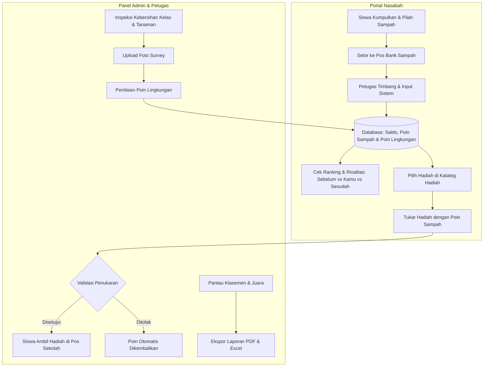

<p align="center">
  
  &nbsp;&nbsp;&nbsp;&nbsp;&nbsp;&nbsp;&nbsp;&nbsp;
  
</p>

<h1 align="center">♻️ Bank Samsul (Bank Sampah Digital)</h1>
<p align="center">
  <b>Sistem Informasi Pengelolaan Bank Sampah, Gamifikasi Poin Reward & Monitoring Kebersihan Lingkungan Sekolah</b><br>
  <i>SMP 2 Al-Muhajirin Purwakarta</i>
</p>

<p align="center">
  
  
  
  
  
  
  
  
</p>

---

## 📌 Tentang Sistem

**Bank Samsul** (*GreenSaver / Bank Sampah SMPS 2 Al-Muhajirin Purwakarta*) adalah ekosistem digital terintegrasi yang mentransformasi pengelolaan sampah dan edukasi kebersihan lingkungan hidup di sekolah.

Aplikasi ini menggabungkan prinsip **3R (Reduce, Reuse, Recycle)** dengan mekanisme **gamifikasi modern (Poin Sampah & Poin Lingkungan)**. Siswa tidak hanya menabungkan sampah untuk memperoleh saldo tabungan rupiah, tetapi juga mengumpulkan poin reward yang dapat ditukarkan dengan hadiah edukatif, bersaing secara sehat di papan klasemen sekolah, serta memantau kondisi kebersihan kelas mereka secara transparan.

---

## 🚀 Fitur Unggulan

### 1. 👥 Multi-Role Authorization (Role-Based Access)
- **👑 Administrator**: Kontrol menyeluruh atas sistem, manajemen pengguna, kategori sampah, katalog barang reward, persetujuan penukaran hadiah, validasi transaksi penarikan saldo, monitoring survey lingkungan, rekapitulasi poin, dan laporan analitik.
- **👮 Petugas**: Operasional penimbangan sampah di pos bank sampah, pencatatan setoran siswa, verifikasi fisik pengambilan hadiah, penyerahan tabungan, dan pelaksanaan inspeksi survey lingkungan kelas.
- **🎓 Nasabah (Siswa / Perwakilan Kelas)**: Portal siswa modern dan responsif untuk memantau saldo, mutasi poin sampah & lingkungan, menukar hadiah di katalog, melihat rivalitas peringkat kelas, dan mengecek hasil inspeksi kebersihan.

### 2. 🏆 Papan Peringkat & Rivalitas Siswa (Leaderboard & Rivalry)
- **Di Portal Admin (`/peringkat`)**:
  - Ringkasan KPI: Total Siswa Aktif, Poin Tertinggi, Rata-Rata Poin, dan Total Sampah Terkumpul.
  - **Podium Juara 3 Besar**: Visualisasi juara 🥇 Juara 1, 🥈 Juara 2, dan 🥉 Juara 3 lengkap dengan rincian poin sampah, poin lingkungan, dan berat sampah.
  - **Tabel Peringkat Lengkap**: Daftar seluruh siswa sekolah terurut otomatis berdasarkan akumulasi poin, dilengkapi pencarian langsung (*live search*).
- **Di Portal Siswa (`/nasabah-dashboard`)**:
  - **Interactive Rivalry Bar**: Menampilkan posisi peringkat siswa saat ini (`#X dari N Siswa`).
  - **Informasi Siswa Sebelumnya (Di Atas Kamu)**: Menampilkan nama siswa 1 peringkat di atasnya serta **selisih poin yang dibutuhkan untuk menyalip posisinya**. Jika berada di peringkat #1, otomatis menampilkan lencana *👑 Juara Puncak*.
  - **Informasi Siswa Sesudahnya (Di Bawah Kamu)**: Menampilkan nama siswa 1 peringkat di bawahnya serta **jarak aman keunggulan poin**.
  - **Arena Duel 3 Pilar**: Kartu interaktif *Sebelum vs Posisi Kamu vs Sesudah*.
  - **Banner Motivasi Dinamis**: Pesan pemacu semangat yang disesuaikan secara otomatis berdasarkan gap poin dengan rival terdekat.
  - **Podium & Klasemen Sekolah**: Melihat posisi 3 besar duta lingkungan sekolah dengan penanda khusus `(Kamu)`.

### 3. 🎁 Katalog Hadiah & Penukaran Poin (Redeem Rewards)
- **Katalog Barang Edukatif**: Alat tulis, tumbler ramah lingkungan, bibit tanaman, buku, hingga sertifikat penghargaan duta lingkungan.
- **Poin Sampah Sebagai Alat Tukar**: Menggunakan saldo Poin Sampah yang didapat dari aktivitas penyetoran sampah terpilah.
- **Form Penukaran Fleksibel**: Pengaturan jumlah item (*stepper*) dan penentuan tanggal pengambilan barang di pos sekolah (minimal $H+1$).
- **Pembatalan Mandiri**: Nasabah dapat membatalkan penukaran sendiri jika barang masih dalam status `menunggu`, dan poin akan dikembalikan secara utuh seketika (*auto-refund*).
- **Verifikasi Dua Langkah di Admin**: Admin menyetujui/menolak permohonan penukaran, dan petugas menandai ketika barang telah diserahkan secara fisik ke siswa.

### 4. 🗑️ Kategori Sampah & Transaksi Setoran
- Pengelompokan jenis sampah ke dalam kategori **Organik** dan **Anorganik**.
- Perhitungan otomatis nilai saldo uang: `Berat (kg) × Harga per kg`.
- Akumulasi otomatis **Poin Sampah** ke akun siswa setiap kali melakukan penyetoran sampah.
- Riwayat setoran detail dan riwayat mutasi buku kas digital.

### 5. 📸 Survey & Monitoring Lingkungan Sekolah
- Pencatatan kondisi kebersihan ruang kelas dan taman sekolah berdasarkan 3 indikator:
  - ♻️ **Pemilahan Sampah** (*Sesuai / Tidak Sesuai*)
  - ✨ **Kebersihan Kelas** (*Bersih / Kotor*)
  - 🌿 **Perawatan Tanaman** (*Disiram & Terawat / Layu & Kering*)
- Unggah foto dokumentasi bukti survey langsung ke penyimpanan publik (*storage link*).
- Modul penilaian rating performa kelas yang otomatis mengonversi hasil survey menjadi **Poin Lingkungan**.

### 6. 📊 Laporan Analitik & Ekspor Dokumen
- Visualisasi grafik interaktif (**Chart.js**): Tren setoran bulanan, distribusi jenis sampah, rasio organik vs anorganik, dan grafik nasabah teraktif.
- **Ekspor Excel (.xlsx)**: Rekapitulasi data transaksi setoran, nasabah, dan kas via *Maatwebsite Excel*.
- **Ekspor PDF Siap Cetak**: Berkas laporan resmi dengan kop surat lembaga via *Barryvdh DomPDF*.

### 7. 📱 Mobile-First User Experience
- Portal nasabah dioptimalkan untuk perangkat smartphone dengan **Mobile Bottom Navigation Dock** dan **Quick Feature Tiles**.
- Tampilan responsif bebas lag (*anti-slop, lightweight, pure modern CSS tokens*).

### 8. ⚙️ cPanel Deployment & Artisan Web Runner (Tanpa SSH)
- Solusi khusus untuk hosting cPanel / Shared Hosting yang tidak memiliki terminal SSH:
  - 🚀 **Migrate Database Web**: Menjalankan `php artisan migrate --force` langsung lewat klik browser.
  - 🔗 **Storage Link Web**: Membuat tautan symlink `public/storage` secara otomatis (dilengkapi fallback symlink manual).
  - 🧹 **Bersihkan Cache**: Menjalankan `php artisan optimize:clear` (config, route, view, cache).
  - ⚡ **Setup Lengkap 1-Klik**: Menjalankan storage link, clear cache, dan migrasi sekaligus secara berurutan.
  - 🌱 **Jalankan Seeder**: Menjalankan `php artisan db:seed --force` untuk mengisi akun demo dan data master.
  - 🔒 **Proteksi Deploy Key**: Dilindungi token otentikasi `DEPLOY_KEY=samsul2026` agar tidak dapat diakses pihak luar.

---

## 🛠️ Arsitektur & Teknologi

| Lapisan | Komponen / Library | Keterangan |
| :--- | :--- | :--- |
| **Backend** | Laravel 10.x | RESTful API Backend & Server logic |
| **Bahasa** | PHP 8.1+ | Server-side execution |
| **Autentikasi** | Laravel Sanctum | Token-based Authentication |
| **Frontend SPA** | Vue.js 3.5 (`<script setup>`) | Single Page Application reaktif |
| **State Management** | Pinia 2.3 | State global autentikasi dan session |
| **Routing** | Vue Router 4.6 | Client-side routing dengan Auth Guards |
| **Bundler & Build** | Vite 5.4 | Hot Module Replacement (HMR) & aset bundler |
| **UI & Styling** | Custom CSS Tokens + Bootstrap Icons | Ultra-lightweight, high-density, anti-slop design |
| **Visualisasi Data** | Chart.js 4.5 | Grafik interaktif batang, garis, dan donat |
| **Notifikasi** | SweetAlert2 | Modal dialog dan konfirmasi interaktif |
| **Spreadsheet** | Maatwebsite Excel 3.1 | Impor data nasabah & ekspor laporan |
| **PDF Renderer** | Barryvdh DomPDF 3.1 | Cetak berkas laporan resmi |
| **Database** | MySQL / MariaDB | Relational Database Management System |

---

## 🔄 Diagram Alur Sistem (Workflow)



---

## 📁 Struktur Direktori Proyek

```text
banksampah-fd/
├── app/
│   ├── Exports/               # Ekspor data Excel (LaporanExport, NasabahTemplateExport)
│   ├── Http/
│   │   ├── Controllers/       # Controller API & Web:
│   │   │   ├── AuthController.php
│   │   │   ├── BarangRedeemController.php     # CRUD & katalog hadiah reward
│   │   │   ├── CpanelDeployController.php     # Web Artisan Runner cPanel (Tanpa SSH)
│   │   │   ├── KategoriSampahController.php
│   │   │   ├── LandingController.php          # Publik data statistik landing
│   │   │   ├── LaporanController.php
│   │   │   ├── MeController.php               # Data profil nasabah
│   │   │   ├── NasabahController.php
│   │   │   ├── PenilaianPoinController.php
│   │   │   ├── PenukaranController.php        # Alur penukaran hadiah & verifikasi
│   │   │   ├── PeringkatController.php        # Leaderboard & rivalitas sebelum/sesudah
│   │   │   ├── SurveyLingkunganController.php
│   │   │   └── TransaksiController.php
│   │   └── Middleware/        # Middleware otentikasi & hak akses (Sanctum & Roles)
│   ├── Imports/               # Impor data Excel (NasabahImport)
│   └── Models/                # Eloquent Model (User, BarangRedeem, Penukaran, RiwayatPoin, dll)
├── database/
│   ├── migrations/            # Skema tabel database (termasuk penukaran, poin, & barang)
│   └── seeders/               # Data awal master & akun pengguna default
├── public/                    # Dokumen publik web & file hasil build Vite
├── resources/
│   ├── js/
│   │   ├── components/        # Komponen UI (Navbar.vue, Sidebar.vue)
│   │   ├── layouts/           # Master Layout (MainLayout.vue)
│   │   ├── router/            # Vue Router (index.js)
│   │   ├── stores/            # Store Pinia (useAuthStore.js)
│   │   ├── views/             # Halaman antarmuka Vue:
│   │   │   ├── LandingView.vue            # Halaman utama profil sekolah
│   │   │   ├── LoginView.vue              # Autentikasi dengan vector art interaktif
│   │   │   ├── DashboardView.vue          # Dashboard admin & petugas
│   │   │   ├── PeringkatView.vue          # Klasemen & podium juara admin
│   │   │   ├── BarangRedeemView.vue       # Kelola hadiah reward admin
│   │   │   ├── ValidasiPenukaranView.vue  # Verifikasi penukaran hadiah
│   │   │   ├── NasabahDashboardView.vue   # Portal nasabah (Katalog, Peringkat, Mutasi)
│   │   │   ├── NasabahView.vue            # Manajemen data nasabah
│   │   │   ├── KategoriView.vue           # Manajemen kategori sampah
│   │   │   ├── TransaksiView.vue          # Kasir setoran & timbangan
│   │   │   ├── SurveyLingkunganView.vue   # Inspeksi kebersihan kelas
│   │   │   └── LaporanView.vue            # Analitik & ekspor dokumen
│   │   └── main.js
│   └── views/                 # Blade views (app.blade.php & PDF template)
├── routes/
│   ├── api.php                # Rute API backend terproteksi
│   └── web.php                # Rute SPA fallback & web deployment runner
├── tests/
│   └── Feature/               # Automated Feature Tests (100% Pass)
└── vite.config.js             # Konfigurasi bundler frontend
```

---

## ⚙️ Panduan Instalasi Lokal (Development)

### Prasyarat Sistem
- **PHP** $\ge 8.1$ dengan ekstensi: `pdo_mysql`, `mbstring`, `fileinfo`, `gd`, `zip`
- **Composer** (PHP Package Manager)
- **Node.js** ($\ge 18.x$) & **NPM**
- **MySQL / MariaDB** (Laragon / XAMPP)

### Langkah Instalasi
1. **Clone / Buka Direktori Proyek**:
   ```bash
   cd c:/laragon/www/banksampah-fd
   ```

2. **Salin Environment File**:
   ```bash
   cp .env.example .env
   ```
   Sesuaikan konfigurasi database di `.env`:
   ```env
   DB_CONNECTION=mysql
   DB_HOST=127.0.0.1
   DB_PORT=3306
   DB_DATABASE=samsulfd
   DB_USERNAME=root
   DB_PASSWORD=
   DEPLOY_KEY=samsul2026
   ```

3. **Install Dependensi PHP & JavaScript**:
   ```bash
   composer install
   npm install
   ```

4. **Generate Application Key**:
   ```bash
   php artisan key:generate
   ```

5. **Hubungkan Folder Storage Upload**:
   ```bash
   php artisan storage:link
   ```

6. **Migrasi Database & Seeder**:
   ```bash
   php artisan migrate --seed
   ```

7. **Build Aset Frontend**:
   ```bash
   npm run build
   ```
   *(Atau jalankan `npm run dev` untuk live-reload saat pengembangan)*

8. **Jalankan Web Server**:
   ```bash
   php artisan serve
   ```
   Aplikasi dapat diakses di: **`http://localhost:8000`** (atau via virtual host Laragon: `http://banksampah-fd.test`).

---

## 🌐 Panduan Deployment di cPanel (Shared Hosting Tanpa SSH)

Jika Anda melakukan hosting di cPanel yang **tidak memiliki akses terminal SSH**, gunakan fitur **cPanel Deployment Web Runner** yang telah disediakan:

### 1. Upload File Proyek
1. Kompres seluruh folder proyek ke dalam format `.zip` (pastikan folder `vendor` dan folder `public/build` sudah ter-generate melalui `npm run build`).
2. Upload file `.zip` ke File Manager cPanel, lalu ekstrak.
3. Arahkan *Document Root* domain Anda ke folder **`public`** (atau sesuaikan struktur folder `public_html`).
4. Buat database MySQL di menu **cPanel > MySQL Databases** dan sesuaikan file `.env` di hosting.

### 2. Jalankan Migrasi & Storage Link Lewat Browser
Buka peramban web dan akses URL konsol berikut:
> **`http://domain-anda.com/cpanel?key=samsul2026`**

*(Jika Anda membuka `http://domain-anda.com/cpanel` tanpa key, sistem akan menampilkan form kunci keamanan 403. Masukkan `samsul2026`).*

### 3. Tombol Eksekusi Cepat di Browser:
- ⚡ **Setup Lengkap 1-Klik**: Menjalankan storage:link + clear cache + migrate sekaligus.
- 🚀 **Jalankan Migrate**: `http://domain-anda.com/cpanel/migrate?key=samsul2026`
- 🔗 **Storage Link**: `http://domain-anda.com/cpanel/storage-link?key=samsul2026`
- 🧹 **Bersihkan Cache**: `http://domain-anda.com/cpanel/clear?key=samsul2026`
- 🌱 **Jalankan Seeder**: `http://domain-anda.com/cpanel/seed?key=samsul2026`
- 📊 **Cek Status DB**: `http://domain-anda.com/cpanel/status?key=samsul2026`

*Tips Keamanan: Anda dapat mengubah nilai kunci ini kapan saja dengan mengganti `DEPLOY_KEY=kunci_rahasia_baru` di file `.env` hosting.*

---

## 🔑 Akun Pengguna Bawaan (Hasil Seeding)

Data akun awal untuk pengujian sistem:

| Role | Nama Pengguna | Username | Password Default | Keterangan Akun |
| :--- | :--- | :--- | :--- | :--- |
| **Admin** | Admin GreenSaver | `admin` | `admin123` | Akses penuh modul sistem |
| **Petugas** | Petugas A | `petugas1` | `petugas123` | Operasional timbangan & survey |
| **Nasabah** | Muhlis (Peringkat #3) | `nasabah1` | `123456` | 5.170 Poin Sampah, 65 Poin Lingkungan |
| **Nasabah** | Siti Nurhaliza (Peringkat #1) | `nasabah2` | `123456` | 6.400 Poin Sampah, 400 Poin Lingkungan |
| **Nasabah** | Budi Santoso (Peringkat #2) | `nasabah3` | `123456` | 5.500 Poin Sampah, 300 Poin Lingkungan |
| **Nasabah** | Dewi Lestari (Peringkat #4) | `nasabah4` | `123456` | 3.900 Poin Sampah, 200 Poin Lingkungan |
| **Nasabah** | Ahmad Fauzan (Peringkat #5) | `nasabah5` | `123456` | 2.600 Poin Sampah, 150 Poin Lingkungan |

> ⚠️ **Peringatan Keamanan**: Segera ganti seluruh kata sandi akun di atas saat aplikasi digunakan di server produksi!

---

## 📡 Ringkasan Endpoint API Utama

Semua endpoint privat mewajibkan header `Authorization: Bearer <token>` dari **Laravel Sanctum**.

### Autentikasi & Profil
- `POST /api/login` — Login pengguna & pembuatan Bearer Token
- `POST /api/logout` — Pencabutan Bearer Token
- `GET /api/me` — Profil akun aktif pengguna
- `GET /api/landing` — Data publik statistik bank sampah untuk landing page

### Papan Peringkat & Rivalitas Siswa
- `GET /api/me/peringkat` — **(Khusus Nasabah)** Peringkat dirinya, data rival di atasnya (`sebelum`), rival di bawahnya (`sesudah`), selisih poin menyalip, teks motivasi, podium, dan leaderboard.
- `GET /api/admin/peringkat` — **(Admin & Petugas)** Rekapitulasi penuh leaderboard, ringkasan KPI, dan podium 3 besar.

### Katalog & Penukaran Hadiah Reward
- `GET /api/barang-redeem` — Katalog barang reward aktif (dapat diakses nasabah)
- `GET /api/admin/barang-redeem` — CRUD daftar hadiah reward (Admin)
- `POST /api/admin/barang-redeem` — Tambah barang hadiah baru + foto
- `POST /api/me/penukaran` — Pengajuan penukaran hadiah oleh nasabah
- `GET /api/me/penukaran` — Riwayat status penukaran hadiah nasabah
- `POST /api/me/penukaran/{id}/batal` — Pembatalan penukaran oleh nasabah (auto-refund poin)
- `GET /api/admin/penukaran` — Daftar seluruh permohonan penukaran siswa
- `POST /api/admin/penukaran/{id}/validasi` — Persetujuan (`disetujui`) / Penolakan (`ditolak`) hadiah
- `POST /api/admin/penukaran/{id}/ambil` — Tandai barang telah diambil siswa (`diambil`)
- `GET /api/admin/notifikasi` — Hitung jumlah penukaran berstatus `menunggu`

### Transaksi, Survey & Penilaian
- `POST /api/transaksi/setoran` — Setor sampah (kalkulasi saldo & reward poin)
- `GET /api/me/setoran` — Riwayat setoran sampah nasabah
- `GET /api/me/riwayat-poin` — Histori mutasi poin sampah & lingkungan
- `GET /api/survey-lingkungan` — Daftar seluruh inspeksi survey kebersihan
- `POST /api/survey-lingkungan` — Tambah data survey + upload foto
- `GET /api/survey-lingkungan/saya` — Riwayat survey kelas milik nasabah
- `GET /api/laporan/dashboard` — Metrik KPI dashboard admin
- `GET /api/laporan/bulan` — Data analitik grafik bulanan
- `GET /api/laporan/export-excel` — Ekspor laporan transaksi ke Excel
- `GET /api/laporan/export-pdf` — Ekspor laporan transaksi ke PDF

---

## 🧪 Pengujian Otomatis (Automated Testing)

Aplikasi dilengkapi dengan suite pengujian otomatis komprehensif menggunakan **PHPUnit**:
```bash
php artisan test
```

Hasil verifikasi pengujian:
```text
PASS  Tests\Unit\ExampleTest
PASS  Tests\Feature\BankSampahPoinTest
PASS  Tests\Feature\PeringkatTest
PASS  Tests\Feature\CpanelDeployTest
PASS  Tests\Feature\ExampleTest

Tests:    23 passed (97 assertions)
Duration: 2.95s
```

---

## 🏫 Identitas Sekolah & Kontak

- **Lembaga**: SMP 2 Al-Muhajirin Purwakarta
- **Sistem**: Bank Samsul (*GreenSaver Digital Waste Bank*)
- **Domain Resmi**: `bank.smp2almuhajirin.sch.id`
- **Operasional**: Senin – Jumat (07:00 – 15:00 WIB)
- **Email**: `banksamsul@smps2almuhajirin.sch.id`

---

<p align="center">
  Dibuat dengan ❤️ untuk Masa Depan Lingkungan Sekolah yang Bersih, Asri, dan Berkelanjutan.<br>
  <b>SMP 2 Al-Muhajirin Purwakarta &copy; 2026</b>
</p>
