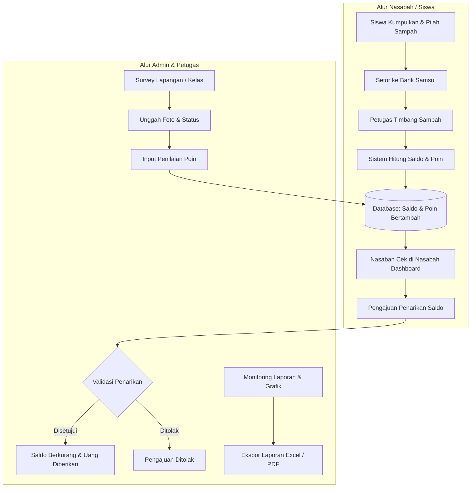

<p align="center">
  
  &nbsp;&nbsp;&nbsp;&nbsp;&nbsp;&nbsp;&nbsp;&nbsp;
  
</p>

<h1 align="center">♻️ Bank Samsul (Bank Sampah Digital)</h1>
<p align="center">
  <b>Sistem Informasi Pengelolaan Bank Sampah & Monitoring Kebersihan Lingkungan Sekolah</b><br>
  <i>SMP 2 Al-Muhajirin Purwakarta</i>
</p>

<p align="center">
  
  
  
  
  
  
</p>

---

## 📌 Tentang Sistem

**Bank Samsul** (Bank Sampah SMPS 2 Al-Muhajirin Purwakarta / *GreenSaver*) adalah sistem informasi berbasis web yang dirancang untuk mendigitalkan seluruh ekosistem pengelolaan bank sampah di lingkungan sekolah.

Aplikasi ini mengadopsi prinsip **3R (Reduce, Reuse, Recycle)** dengan memfasilitasi siswa/kelas untuk mengumpulkan, memilah, dan menabungkan sampah bernilai ekonomis. Selain mengonversi sampah menjadi saldo tabungan dan poin penghargaan, sistem ini dilengkapi fitur monitoring lingkungan hidup sekolah (kebersihan kelas, pemilahan sampah, dan perawatan tanaman) secara berkala.

---

## 🚀 Fitur Utama

### 1. 👥 Multi-Role Authorization (Role-Based Access)
Sistem memiliki 3 tingkat hak akses dengan antarmuka yang disesuaikan secara dinamis:
- **👑 Administrator**: Akses penuh ke seluruh menu sistem, manajemen pengguna/nasabah, kategori sampah, validasi transaksi penarikan saldo, audit survey lingkungan, input penilaian poin, serta laporan analitik dan ekspor dokumen.
- **👮 Petugas**: Bertanggung jawab atas operasional lapangan, meliputi pendaftaran nasabah, pencatatan setoran sampah, eksekusi penarikan saldo langsung, input survey lingkungan kelas, dan monitoring laporan.
- **🎓 Nasabah (Siswa / Perwakilan Kelas)**: Memiliki portal dashboard mandiri untuk memantau saldo tabungan, akumulasi poin reward, riwayat transaksi, pengajuan penarikan saldo secara mandiri, dan monitoring rekam jejak survey lingkungan.

### 2. 📋 Manajemen Data Nasabah
- Operasi CRUD (Tambah, Edit, Hapus) nasabah dengan username unik dan sandi terenkripsi (Hash/Bcrypt).
- Fitur pencarian (*live search*) dan paginasi data otomatis.
- **Import Nasabah Massal via Excel**: Mengimpor data siswa/nasabah sekaligus melalui file `.xlsx` / `.xls` / `.csv`.
- **Unduh Template Excel**: Menyediakan format template impor resmi untuk meminimalkan kesalahan input data.

### 3. 🗑️ Manajemen Kategori & Jenis Sampah
- Pengelompokan sampah ke dalam klasifikasi **Organik** dan **Anorganik**.
- Penyesuaian satuan timbangan (kg) serta konfigurasi tarif harga per kilogram secara dinamis.

### 4. 💰 Transaksi Setoran Sampah & Gamifikasi Poin
- Perhitungan otomatis nilai setoran berdasarkan rumus: `Berat (kg) × Harga per kg`.
- **Sistem Poin Reward**: Otomatisasi reward poin (1 Poin per 1 kg sampah yang disetorkan) yang langsung diakumulasikan ke profil nasabah.
- Pencatatan transaksi real-time ke dalam buku kas digital dan histori mutasi saldo.

### 5. 💳 Alur Penarikan Saldo & Validasi
- **Penarikan Langsung**: Dilakukan di tempat oleh Admin atau Petugas dengan validasi saldo instan.
- **Pengajuan Penarikan Mandiri (Nasabah)**: Nasabah dapat mengajukan permintaan penarikan melalui dashboard masing-masing dengan status awal `pending`.
- **Modul Validasi Penarikan**: Admin memiliki wewenang untuk memeriksa, menyetujui (*approve*), atau menolak (*reject*) permohonan penarikan saldo.

### 6. 📸 Survey & Monitoring Lingkungan Sekolah
- Pencatatan survey kondisi lingkungan harian/mingguan berbasis 3 indikator:
  - ♻️ **Pemilahan Sampah** (*Sesuai* / *Tidak Sesuai*)
  - ✨ **Kebersihan Kelas** (*Bersih* / *Tidak Bersih*)
  - 🌿 **Perawatan Tanaman** (*Disiram* / *Tidak Disiram*)
- Unggah foto dokumentasi bukti survey langsung ke penyimpanan publik (*storage link*).

### 7. ⭐ Sistem Penilaian Poin Kebersihan
- Modul penilaian performa lingkungan kelas oleh penilai/petugas:
  - Kebersihan Kelas (Skala Rating: 1 - 10)
  - Pengelolaan Sampah (Skala Rating: 1 - 5)
- Nilai rating langsung ditambahkan ke akumulasi poin nasabah/kelas terkait.

### 8. 📊 Laporan Interaktif & Ekspor Dokumen
- Filter dinamis berdasarkan periode (*Quick Filter*: Hari Ini, Minggu Ini, Bulan Ini, dan custom rentang tanggal).
- Ringkasan KPI: Total Saldo Masuk, Total Saldo Keluar, dan Nasabah Aktif.
- Visualisasi grafik interaktif menggunakan **Chart.js**:
  - Tren setoran bulanan (Line Chart)
  - Distribusi berat sampah per jenis (Bar Chart)
  - Proporsi transaksi per nasabah (Pie Chart)
  - Komparasi setoran kategori Organik vs Anorganik
- Informasi *Leaderboard* Nasabah dengan kontribusi setoran terbesar (Top Organik & Top Anorganik).
- Rekapitulasi hasil survey lingkungan sekolah.
- **Ekspor Dokumen**:
  - Unduh Laporan Rekapitulasi format **Excel (.xlsx)** via Maatwebsite Excel.
  - Cetak Laporan Resmi format **PDF** siap cetak via Barryvdh DomPDF.

---

## 🛠️ Arsitektur & Teknologi

| Komponen | Teknologi | Deskripsi |
| :--- | :--- | :--- |
| **Backend Framework** | Laravel 10.x | RESTful API Backend & Server logic |
| **Bahasa Pemrograman** | PHP 8.1+ | Server-side execution |
| **Autentikasi API** | Laravel Sanctum | Bearer Token-based stateful/stateless auth |
| **Frontend Framework** | Vue.js 3.5 (SFC, `<script setup>`) | Single Page Application (SPA) arsitektur |
| **State Management** | Pinia 2.3 | Manajemen state global (Auth, Token, User session) |
| **Frontend Router** | Vue Router 4.6 | Navigasi halaman SPA & Route Navigation Guards |
| **Build Tool & Bundler** | Vite 5.4 | Hot Module Replacement (HMR) & bundling cepat |
| **UI & Styling** | Bootstrap 5.3 + Tailwind CSS 4.x | Layout responsif, utility modern, dan Bootstrap Icons |
| **Visualisasi Data** | Chart.js 4.5 | Grafik interaktif batang, garis, dan lingkaran |
| **Notifikasi & Dialog** | SweetAlert2 | Modal alert interaktif dan konfirmasi aksi |
| **Manipulasi Excel** | Maatwebsite Excel 3.1 | Impor data nasabah & ekspor laporan format spreadsheet |
| **Generator PDF** | Barryvdh Laravel DomPDF 3.1 | Pembuatan laporan arsip berformat PDF |
| **Database** | MySQL | Relational Database Management System |

---

## 🔄 Alur Kerja Sistem (Workflow)



---

## 📁 Struktur Direktori Proyek

```text
banksampah-fd/
├── app/
│   ├── Exports/               # Class ekspor data (LaporanExport, NasabahTemplateExport)
│   ├── Http/
│   │   ├── Controllers/       # Controller API (Auth, Nasabah, Transaksi, Laporan, Survey, dll)
│   │   └── Middleware/        # Middleware otentikasi & pengecekan role
│   ├── Imports/               # Class impor data Excel (NasabahImport)
│   └── Models/                # Eloquent Model (User, Setoran, Penarikan, Kategori, Survey, dll)
├── config/                    # Konfigurasi Laravel
├── database/
│   ├── migrations/            # Skema migrasi tabel database
│   └── seeders/               # Seeder user default (Admin, Petugas, Nasabah)
├── public/                    # Entry point publik Laravel & aset hasil kompilasi
├── resources/
│   ├── js/
│   │   ├── assets/            # File CSS khusus (landing.css, dll)
│   │   ├── components/        # Komponen Vue reusable (Navbar.vue, Sidebar.vue)
│   │   ├── layouts/           # Master layout Vue (MainLayout.vue)
│   │   ├── plugins/           # Integrasi plugin pendukung (swal.js)
│   │   ├── router/            # Konfigurasi Vue Router (index.js)
│   │   ├── stores/            # Store Pinia (useAuthStore.js)
│   │   ├── views/             # Halaman tampilan antarmuka Vue:
│   │   │   ├── LandingView.vue
│   │   │   ├── LoginView.vue
│   │   │   ├── DashboardView.vue
│   │   │   ├── NasabahView.vue
│   │   │   ├── KategoriView.vue
│   │   │   ├── TransaksiView.vue
│   │   │   ├── ValidasiPenarikanView.vue
│   │   │   ├── NasabahDashboardView.vue
│   │   │   ├── SurveyLingkunganView.vue
│   │   │   └── LaporanView.vue
│   │   ├── App.vue            # Root Component Vue
│   │   └── main.js            # Inisialisasi frontend Vue & library
│   └── views/
│       ├── app.blade.php      # Single Page Shell View Laravel
│       └── pdf/               # Template Blade untuk cetak laporan PDF
├── routes/
│   ├── api.php                # Rute API backend (Protected Sanctum & Role groups)
│   └── web.php                # Fallback route untuk mengarahkan ke SPA Vue
├── storage/                   # File log, cache, dan hasil unggahan foto survey
├── composer.json              # Manajemen dependensi PHP
├── package.json               # Manajemen dependensi JavaScript
└── vite.config.js             # Konfigurasi bundler Vite
```

---

## ⚙️ Panduan Instalasi & Menjalankan Sistem

Pastikan komputer/server telah terpasang:
- **PHP** minimal versi 8.1 dengan ekstensi `pdo_mysql`, `fileinfo`, `gd`, `zip` aktif
- **Composer** (PHP Package Manager)
- **Node.js** (versi 18.x atau yang lebih baru) & **NPM**
- **MySQL / MariaDB** (melalui Laragon, XAMPP, atau instalasi native)

### 1. Kloning / Buka Direktori Proyek
Buka terminal dan arahkan ke direktori kerja aplikasi:
```bash
cd c:/laragon/www/bank.smp2almuhajirin.sch.id/banksampah-fd
```

### 2. Konfigurasi Environment (`.env`)
Salin file `.env.example` menjadi `.env` jika belum tersedia:
```bash
cp .env.example .env
```
Buka file `.env` dan sesuaikan koneksi database MySQL:
```ini
APP_NAME="Bank Samsul"
APP_ENV=local
APP_KEY=
APP_DEBUG=true
APP_URL=http://localhost:8000

DB_CONNECTION=mysql
DB_HOST=127.0.0.1
DB_PORT=3306
DB_DATABASE=samsulfd
DB_USERNAME=root
DB_PASSWORD=
```

### 3. Instalasi Dependensi Backend (Composer)
```bash
composer install
```

### 4. Generate Application Key
```bash
php artisan key:generate
```

### 5. Buat Tautan Simbolik Storage (*Storage Symlink*)
Wajib dijalankan agar foto hasil unggahan survey lingkungan dapat diakses publik:
```bash
php artisan storage:link
```

### 6. Migrasi Database & Seeding Data Awal
Buat database di MySQL sesuai nama pada `.env` (contoh: `samsulfd`), lalu jalankan migrasi dan seeder:
```bash
php artisan migrate --seed
```

### 7. Instalasi Dependensi Frontend (Node.js / NPM)
```bash
npm install
```

### 8. Menjalankan Aplikasi
Jalankan dev-server frontend (Vite) dan backend server (Laravel):

**Terminal 1 (Vite Development Server):**
```bash
npm run dev
```

**Terminal 2 (Laravel Development Server):**
```bash
php artisan serve
```

Aplikasi dapat diakses melalui peramban web pada alamat:
👉 **[http://localhost:8000](http://localhost:8000)** 

---

## 🔑 Akun Pengguna Default (Hasil Seeder)

Untuk keperluan pengujian awal sistem, data pengguna bawaan berikut telah disediakan:

| Role | Username | Password | Deskripsi Akses |
| :--- | :--- | :--- | :--- |
| **Admin** | `admin` | `admin123` | Akses penuh seluruh modul dan konfigurasi |
| **Petugas** | `petugas1` | `petugas123` | Akses operasional setoran, penarikan & survey |
| **Nasabah** | `nasabah1` | `nasabah123` | Portal nasabah siswa (Saldo awal: Rp 25.000) |

---

## 🌐 Ringkasan Endpoint API

Semua endpoint API diproteksi menggunakan Bearer Token dari **Laravel Sanctum**.

### Autentikasi
- `POST /api/login` — Autentikasi pengguna & pembuatan token akses
- `GET /api/me` — Mendapatkan profil pengguna yang sedang login

### Khusus Admin & Petugas (`role:admin,petugas`)
- `GET /api/nasabah` — Menampilkan daftar semua nasabah
- `POST /api/nasabah` — Menambahkan data nasabah baru
- `GET /api/nasabah/template` — Unduh template file Excel untuk impor data nasabah
- `POST /api/nasabah/import` — Unggah dan impor massal data nasabah via Excel
- `GET /api/nasabah/{id}` — Detail informasi nasabah
- `PUT /api/nasabah/{id}` — Pembaruan data profil nasabah
- `DELETE /api/nasabah/{id}` — Penghapusan data nasabah *(Admin)*
- `GET /api/kategori` — Menampilkan katalog kategori sampah
- `POST /api/kategori` — Menambahkan kategori sampah baru
- `PUT /api/kategori/{id}` — Mengubah kategori sampah
- `DELETE /api/kategori/{id}` — Menghapus kategori sampah
- `POST /api/transaksi/setoran` — Pencatatan setoran sampah baru (kalkulasi saldo & poin)
- `POST /api/transaksi/penarikan` — Eksekusi penarikan saldo
- `GET /api/penarikan` — Daftar permohonan penarikan saldo
- `POST /api/penarikan/validasi/{id}` — Validasi permohonan penarikan (`disetujui` / `ditolak`)
- `GET /api/laporan/bulan` — Data analitik laporan berkala dan ringkasan KPI
- `GET /api/laporan/dashboard` — Data ringkasan statistik untuk dashboard admin
- `GET /api/laporan/export-excel` — Ekspor file laporan rekapitulasi ke Excel
- `GET /api/laporan/export-pdf` — Ekspor berkas laporan resmi ke format PDF
- `GET /api/survey-lingkungan` — Daftar hasil survey lingkungan
- `POST /api/survey-lingkungan` — Input survey baru disertai unggahan foto
- `DELETE /api/survey-lingkungan/{id}` — Hapus data survey lingkungan
- `GET /api/penilaian-poin` — Riwayat penilaian poin kebersihan
- `POST /api/penilaian-poin` — Penilaian baru rating kebersihan kelas & sampah

### Khusus Nasabah (`auth:sanctum`)
- `GET /api/transaksi/{user_id}` — Riwayat mutasi transaksi pribadi
- `POST /api/transaksi/penarikan` — Pengajuan penarikan saldo secara mandiri
- `GET /api/survey-lingkungan/saya` — Riwayat survey kebersihan kelas milik nasabah

---

## 🏫 Identitas Lembaga

- **Nama Sekolah**: SMPS 2 Al-Muhajirin Purwakarta
- **Domain Sistem**: `bank.smp2almuhajirin.sch.id`
- **Operasional**: Senin – Jumat (07:00 – 15:00 WIB)
- **Email**: `banksamsul@smps2almuhajirin.sch.id`
- **Kontak**: +62 857-2297-5551

---

## 📄 Lisensi

Sistem ini dikembangkan secara tertutup untuk kegiatan operasional dan edukasi lingkungan hidup di **SMP 2 Al-Muhajirin Purwakarta**. Hak cipta dilindungi undang-undang.
